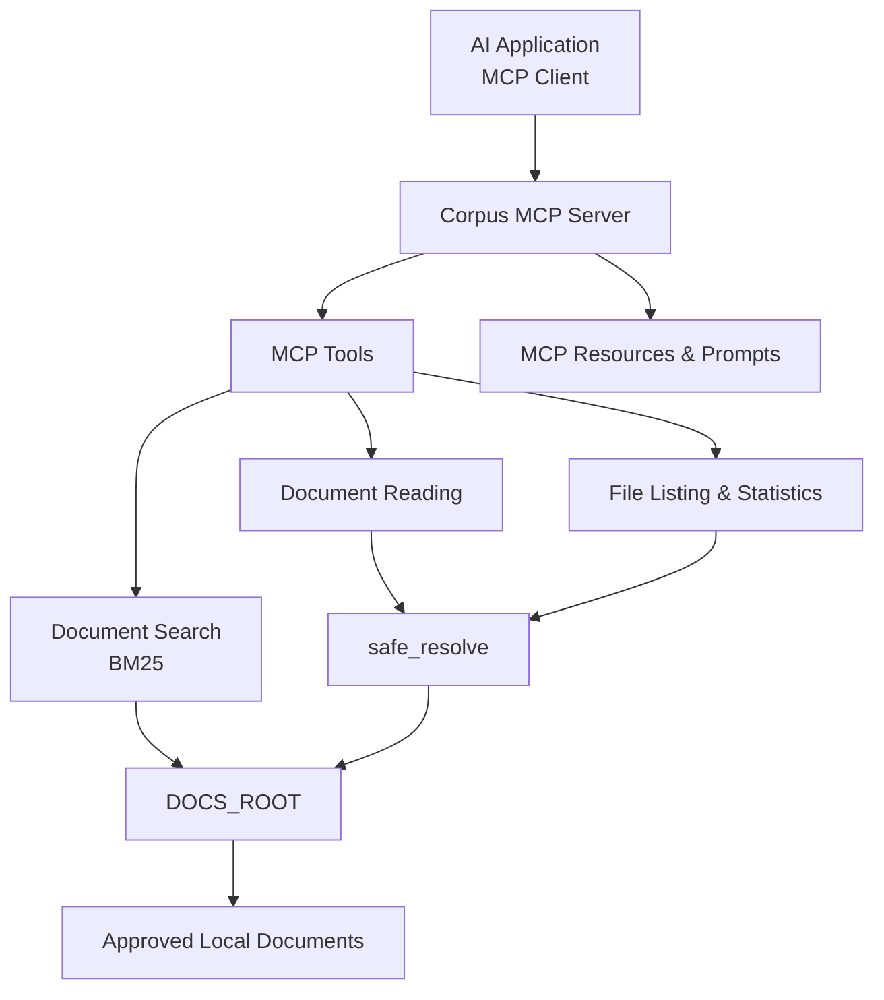

# Corpus MCP
### A Secure Local Document Retrieval Server for AI Applications

Corpus MCP is a local [Model Context Protocol (MCP)](https://modelcontextprotocol.io/) server that enables AI applications to search, read and retrieve information from a designated folder of documents.

It provides structured document-access tools while enforcing filesystem boundaries to prevent access outside the configured document directory.

**Key focus areas:** Document Retrieval · MCP Integration · Filesystem Security · Python · Automated Testing

---

## Overview

AI applications often need access to local documents to provide context-aware responses. However, exposing local files requires careful control over which files can be accessed and how they are retrieved.

Corpus MCP addresses this by providing a controlled interface between AI applications and a user-defined document directory.

The server supports keyword-based document retrieval, file reading, directory listing and document statistics.

## Features

| Feature | Description |
|---|---|
| Document Search | BM25 keyword search with ranked results and snippets |
| Document Reading | Reads document contents with a 20,000-character output limit |
| File Listing | Lists available documents with size and modification details |
| Folder Statistics | Provides file counts, total size and recent-file information |
| MCP Resource | Exposes document access through a `docs://` resource |
| Summarisation Prompt | Provides a `summarize_document` prompt |
| Filesystem Security | Restricts file access to the configured document directory |

## Architecture



The server separates tool logic from MCP registration, allowing the underlying functions to be tested independently.

## Available Tools

### 1. `search_documents`
Searches the document collection using BM25 keyword ranking.

Returns ranked results containing:
- Document path
- Relevance score
- Text snippet

### 2. `read_document`
Reads the contents of an individual document.

- Maximum output: 20,000 characters
- Indicates when content has been truncated.

### 3. `list_documents`
Lists available documents with:
- File size
- Modification time
- Optional extension filtering

### 4. `summarize_folder_stats`
Provides an overview of the document collection:
- File counts by extension
- Total document size
- Most recently modified files

## Security Architecture

Filesystem access is restricted through a central path-validation function called `safe_resolve`.

Security controls include:

- **Path containment:** Resolves paths and verifies that they remain within `DOCS_ROOT`.
- **Symlink protection:** Rejects symbolic links that resolve outside the permitted directory.
- **Extension restrictions:** Supports `.md`, `.txt`, `.py`, `.json`, `.csv` and `.rst`.
- **File-size restriction:** Rejects files larger than 200 KB.
- **Output limits:** Truncates large document outputs.
- **Result limits:** Caps search results at 50.

The test suite includes checks for path traversal, absolute paths and external symbolic links.

## Technology Stack

- **Language:** Python
- **Protocol:** Model Context Protocol (MCP)
- **Search:** BM25 keyword retrieval
- **SDK:** MCP Python SDK v2
- **Transport:** Standard input/output (stdio)
- **Testing:** pytest
- **Package Management:** uv

## Getting Started

### Prerequisites

- Python version compatible with the project configuration
- [uv](https://docs.astral.sh/uv/)
- An MCP-compatible client, such as Claude Desktop

### Installation

Clone the repository:

```bash
git clone https://github.com/KochuthressiaPayankan/corpus-mcp.git
cd corpus-mcp
```

Install dependencies:

```bash
uv sync
```

Run the test suite:

```bash
uv run pytest
```

### Configure Claude Desktop

Add the following configuration to your Claude Desktop configuration file:

`~/Library/Application Support/Claude/claude_desktop_config.json`

```json
{
  "mcpServers": {
    "corpus-mcp": {
      "command": "/absolute/path/to/uv",
      "args": [
        "--directory",
        "/absolute/path/to/corpus-mcp",
        "run",
        "corpus-mcp"
      ],
      "env": {
        "DOCS_ROOT": "/absolute/path/to/your/docs"
      }
    }
  }
}
```

Replace the example paths with your actual absolute paths.

Restart Claude Desktop after saving the configuration.

## Engineering Decisions

**Separation of concerns**

Tool logic is implemented as plain functions, while `server.py` handles MCP registration. This keeps the business logic independently testable.

**Explicit error handling**

Expected failures use `ToolError` messages so that the calling AI application receives useful feedback and can recover from common errors.

**Local-first architecture**

The current implementation uses stdio transport, allowing local integration without introducing a network-facing service.

**Search index maintenance**

The BM25 index rebuilds when documents change, keeping search results aligned with the document collection.

## Testing

The repository includes automated tests covering:

- Tool behaviour
- Filesystem path validation
- Path traversal attempts
- Absolute-path rejection
- External symbolic-link rejection

Run all tests using:

```bash
uv run pytest
```

## Roadmap

Planned improvements include:

- Hybrid search using Qdrant.
- Authenticated Streamable HTTP transport.
- Exploring AWS Lambda deployment.
- Write operations protected by explicit confirmation.

These are planned enhancements and are not part of the current implementation.

## Repository Structure

```text
corpus-mcp/
├── docs/
├── sample_docs/
├── src/
│   └── corpus_mcp/
├── tests/
├── .env.example
├── pyproject.toml
├── README.md
└── uv.lock
```

## Author

**Kochuthressia Payankan**

Computer Science Undergraduate  
Interested in Cloud Solutions, Technology Consulting and AI.

[GitHub](https://github.com/KochuthressiaPayankan) · [LinkedIn](https://www.linkedin.com/in/kochuthressia-payankan-652844220/)

---

*Exploring secure, practical ways to connect AI applications with local knowledge.*

